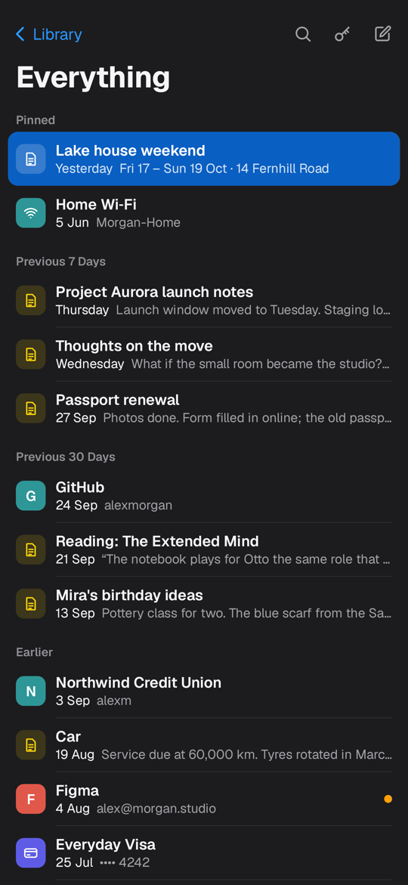
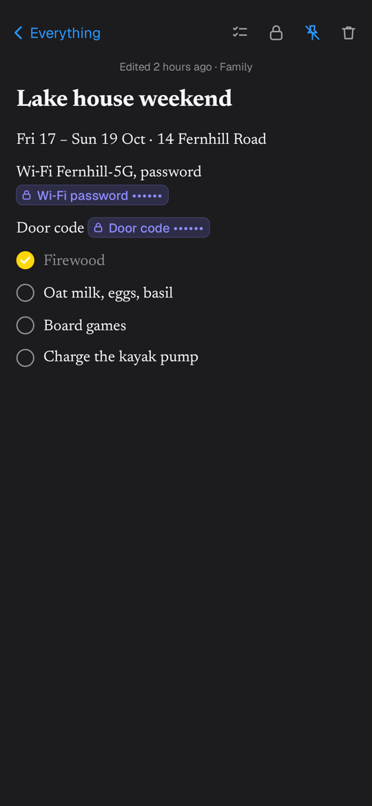
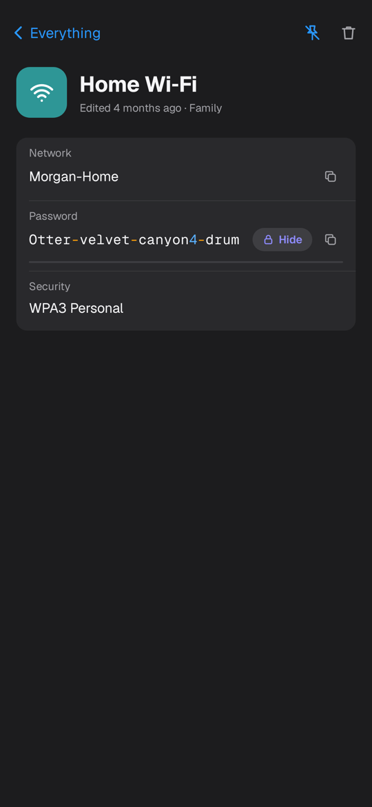
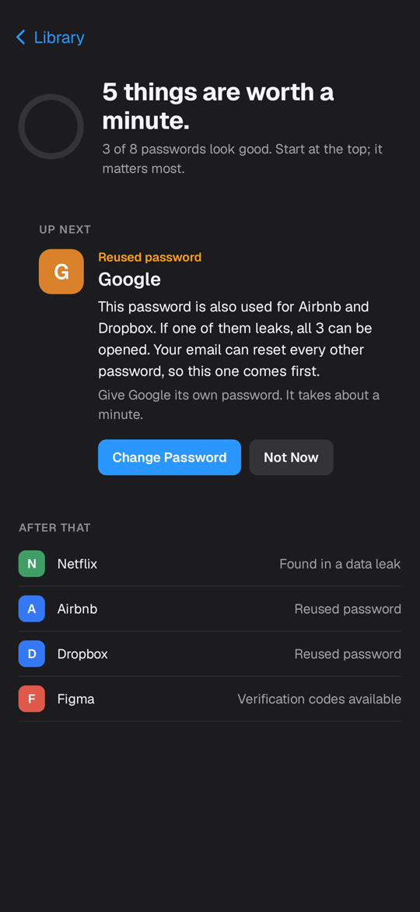
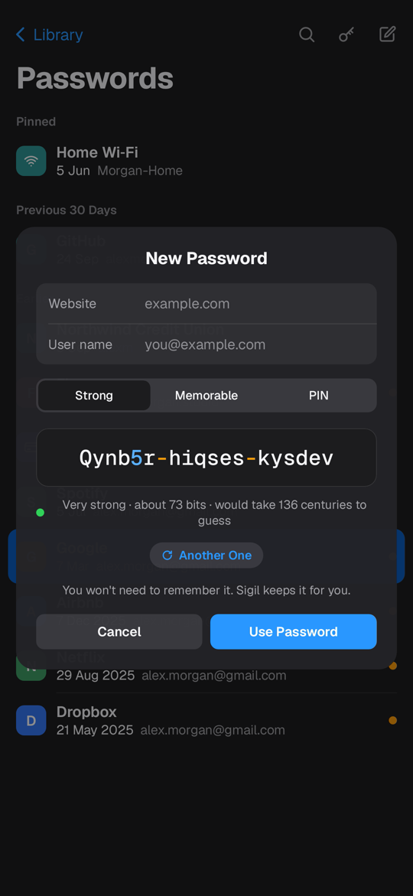
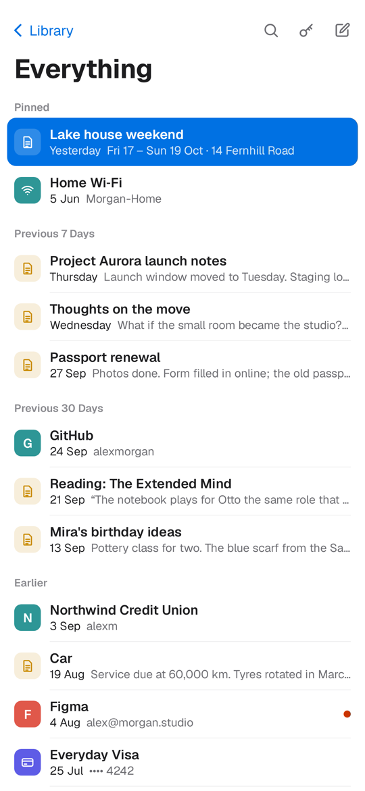

# Sigil

An Android app for notes and passwords in one place, built from the **Kept** prototype
with the same UI, sample content and behavior, renamed Sigil.

<p>






</p>

## What it does

- **Library**: Everything, Notes, Passwords and Pinned; Personal, Family and Work Spaces;
  Check-up; Recently Deleted (kept 30 days, then removed); Lock Sigil.
- **Notes**: the first line is the title, every keystroke is saved, and there are checklists with round
  checkboxes. Type something password-like and Sigil offers *"This looks like a Wi‑Fi password.
  Seal it?"*. Sealed values become indigo chips that open only after a fingerprint, face or screen-lock check.
- **Passwords**: logins, cards and Wi‑Fi. Values stay masked until revealed, then hide again
  after 30 seconds. Copies are marked sensitive and cleared after 60 seconds. Logins can show
  verification codes (RFC 6238) and offer *Change Password…*.
- **Find or keep** (search button, or Ctrl/⌘+K): one field that searches every item. If
  nothing matches, Return keeps what you typed as a new note. Sealed values are never searched.
- **Generator**: Strong, Memorable or PIN, or **Mine** to save a password you already have (typed or pasted, hidden until you tap Show), with digits in blue and symbols in orange, plus a strength estimate.
- **Check-up**: reused passwords, passwords found in a leak, and logins that could use
  verification codes. It shows one issue at a time, most important first, with the fix next to it.
- **Multi-select** in every list: long-press a row (or tap the Select button) to pick several,
  then Pin, Move to a Space, or Delete. In Recently Deleted: Recover, or Delete for good
  (asks first). A single deleted item also has **Delete Now**.
- **Haptics** for navigation, checklists, sealing, reveal and hide, copy, delete and lock, built from
  Android's vibration primitives. They follow the system touch-feedback setting.
- Opens on **Everything**, newest first. Come back within 5 minutes and it resumes on the item you had open.
- **Adaptive layout**: one pane at a time on phones, list and detail with a slide-in sidebar on
  medium widths, and all three panes on tablets. Light and dark themes follow the system.

## Security

- Every secret value is encrypted with AES‑256‑GCM using a key held in the Android Keystore
  (`security/SecretVault.kt`). Only ciphertext is stored in the Room database.
- Revealing or copying a secret needs presence (`BiometricPrompt`: biometrics or the device
  screen lock). One success counts for a minute, as in the prototype.
- While a secret is on screen the window is `FLAG_SECURE`, so it's excluded from screenshots,
  screen recordings and the app switcher. Leaving the app hides everything revealed.
- Backup and device transfer are disabled; the Keystore key can't leave the device anyway.
- Sigil has no network permission. Nothing leaves the phone.

## Differences from the prototype

- Face ID → the Android biometric prompt. Fingerprint, face or screen lock all count.
- No sync or sharing, so Spaces are local and Sigil never says one is "shared with 3 people".
  Copy that promised AutoFill now says what Sigil actually does ("Sigil keeps it for you").
- *Turn On Codes* asks for the site's real setup key instead of inventing one.
- Overlays are nearly opaque instead of blurring what's behind them, because Compose can't
  blur the content under a layer.

## Project layout

| Module | What's in it |
| --- | --- |
| `core/` | Pure Kotlin: password generator, TOTP, secret detection, search, time formatting (unit tested) |
| `app/data` | Room entities/DAOs, repository, sample data |
| `app/editor` | `NoteDoc`: the note text model behind the editor (unit tested) |
| `app/ui` | `SigilViewModel`, screens, overlays, theme (prototype colors, icons and fonts) |

## Build and run

Requires JDK 17+ and the Android SDK (platform 35). Open `sigil/` in Android Studio, or:

```sh
cd sigil
./gradlew :app:assembleDebug          # app/build/outputs/apk/debug/app-debug.apk
./gradlew :core:test :app:testDebugUnitTest
```

`ScreenshotTest` renders the real app on the JVM with Robolectric and Roborazzi. Add
`-Proborazzi.test.record=true` to write the PNGs to `app/build/outputs/roborazzi/`.

The first launch seeds the prototype's fictional sample content (Alex Morgan's notes and
logins). Delete any item to clear it.

## Fonts

Geist, Geist Mono and Newsreader are the prototype's fonts. They're bundled from Google Fonts under
the [SIL Open Font License 1.1](https://openfontlicense.org).
